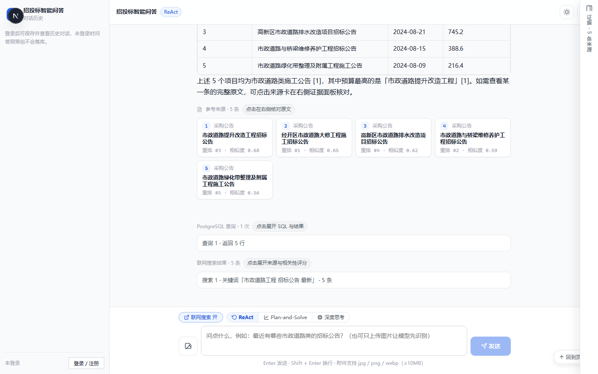
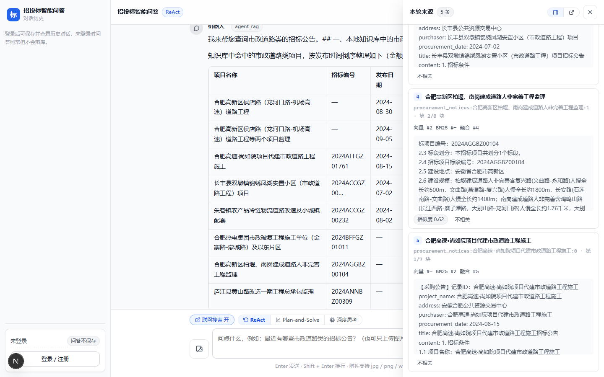
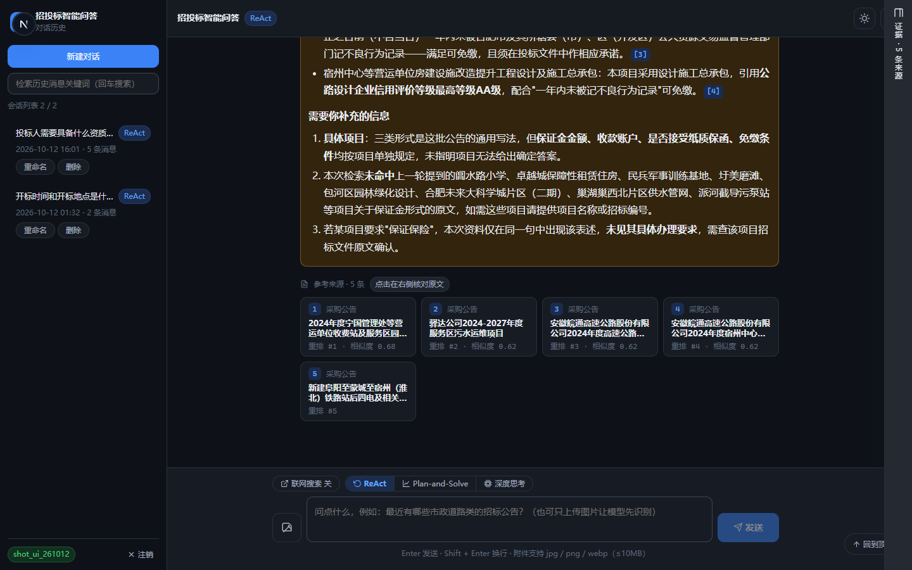
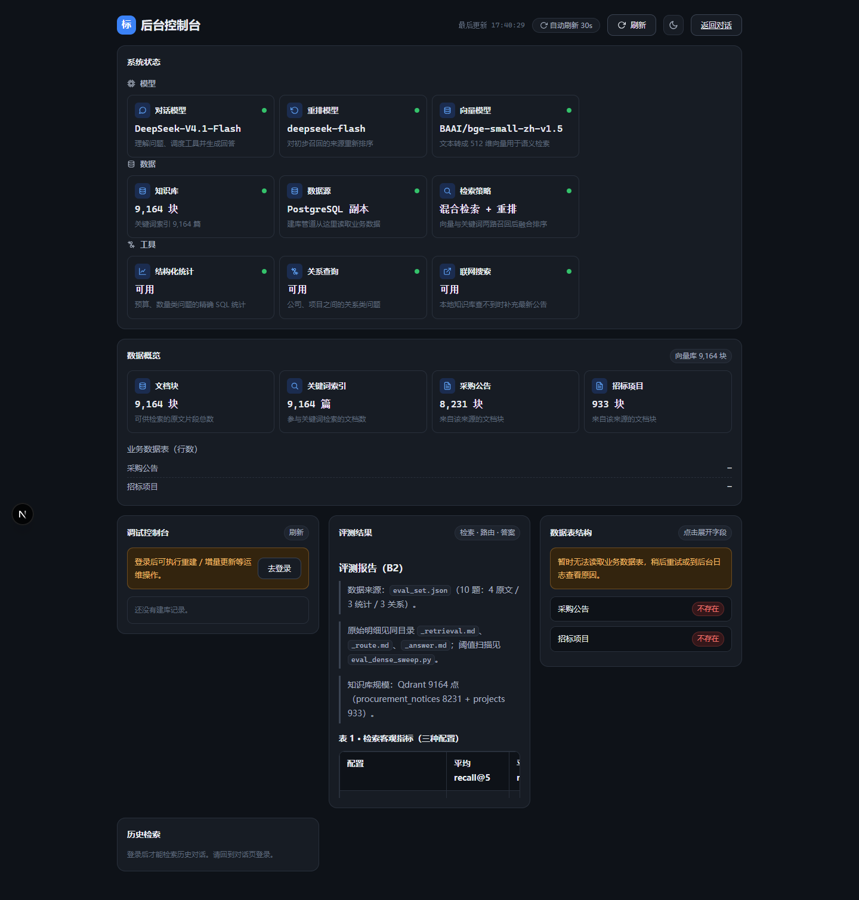
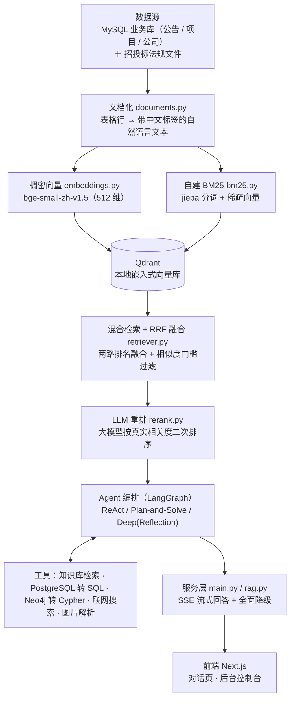
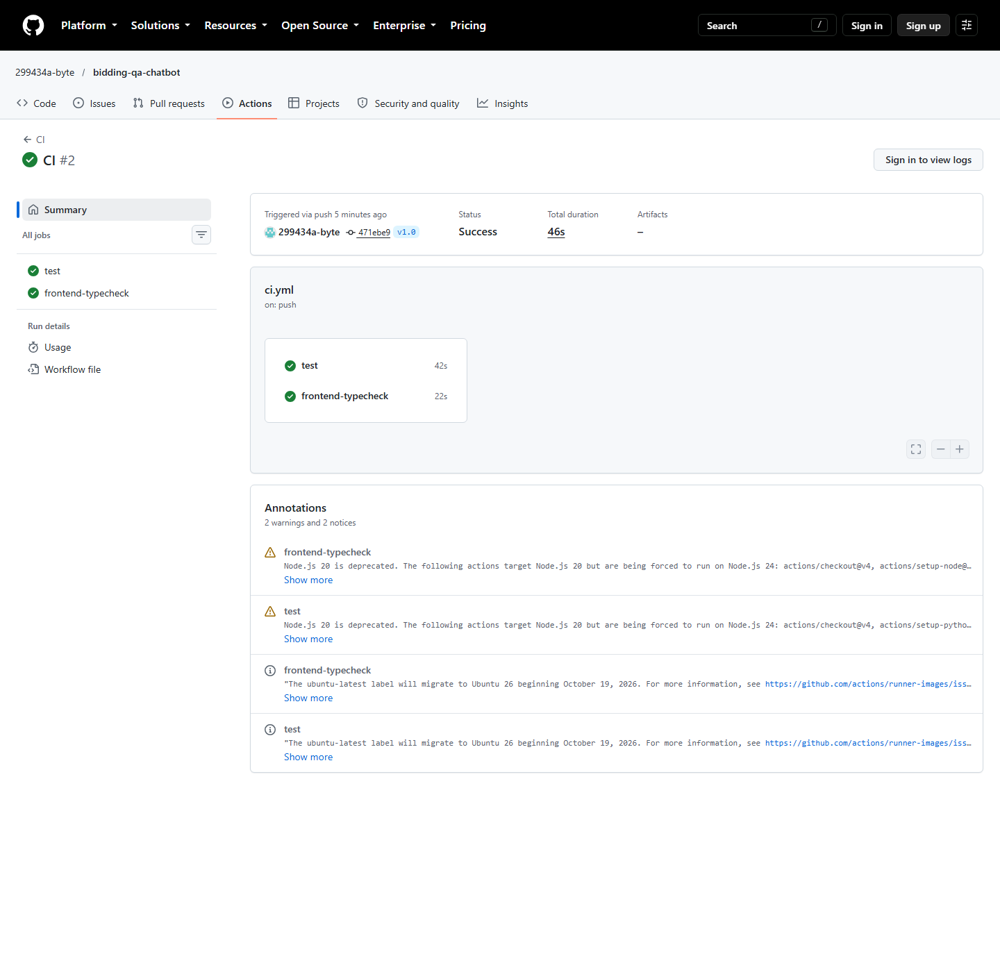

# 招投标智能问答机器人（bidding-qa-chatbot）

[](https://github.com/299434a-byte/bidding-qa-chatbot/actions/workflows/ci.yml) **仓库地址**：<https://github.com/299434a-byte/bidding-qa-chatbot>

> **一句话定位**：把招投标业务库里的结构化数据「翻译」成可检索的知识，让使用者用**一句自然语言**就能查公告、比项目、算统计、追关系——答案带出处，不编造。

## 它解决什么问题

招投标场景的信息散落在三类互不相通的数据里，传统做法要么靠人肉翻库，要么靠关键词死搜：

| 数据形态 | 典型问题 | 传统方式的痛点 |
|---|---|---|
| 招标公告 / 项目 / 公司的**正文** | 「市政道路工程的招标要求有哪些？」 | 关键词搜不到「意思相近但用词不同」的内容 |
| 结构化**明细字段** | 「预算超过 100 万的项目有几个？」 | 关键词检索不会做 count / sum |
| 实体之间的**关系** | 「这家公司中标了哪些项目？」 | 表格查不了多跳关系 |

本项目把这三类问题统一到一个对话入口：**正文走混合检索（语义 + 关键词）**，**统计走 PostgreSQL 自然语言转 SQL**，**关系走 Neo4j 图谱查询**，由 Agent 自主判断该用哪条路，全程 SSE 流式返回，并给出可点击的来源卡片。

## 界面截图

主对话页 · 浅色主题（三栏布局：会话栏 + 对话区 + 证据栏，底部为输入区；流式回答带来源条与工具轨迹）：



回答中的引用序号 `[1]` 可点击：右侧证据面板展开，逐条列出来源原文、向量/BM25/融合/重排四层名次与相似度（重排前后名次差用 ↑↓ 标出，如「融合 #5 重排 #4 ↑1」），支持标记「不相关」：



主对话页 · 暗色主题（右上角可切换浅色 / 暗色 / 跟随系统）：



后台控制台 `/admin`（模型 / 数据 / 工具三组状态卡、数据概览、评测结果、调试控制台与数据表结构）：



## 架构



纯文本版（便于在任意环境阅读）：

```
MySQL 业务库 / 招投标法规文件
        │
        ▼  文档化（表格行 → 自然语言文本，字段名取自库里的列注释）
   稠密向量（bge-small-zh）          自建 BM25（jieba 分词 + 稀疏向量）
        │                                   │
        └──────────────┬────────────────────┘
                       ▼
              Qdrant 本地嵌入式向量库
                       │
                       ▼
        混合检索 + RRF 排名融合 + 相似度门槛过滤
                       │
                       ▼
             LLM 重排（大模型二次排序）
                       │
                       ▼
   Agent 编排（ReAct / Plan-and-Solve / Deep+Reflection）
        ├── 知识库检索工具
        ├── PostgreSQL 自然语言转 SQL
        ├── Neo4j 自然语言转 Cypher
        ├── 联网搜索（Tavily）
        └── 图片解析（智谱视觉模型）
                       │
                       ▼
              SSE 流式回答（含来源卡片）
                       │
                       ▼
              前端 Next.js（对话页 / 后台页）
```

> 说明：当前建库脚本的数据源可切换（`KB_SOURCE`，默认 MySQL，可改读本机 PostgreSQL 副本），两条路径共用同一条「文档化 → 向量化」管线；「法规文件」也可复用同一条管线接入（扩展点）。

## 技术栈与选型理由

| 技术 | 用途 | 为什么选它 |
|---|---|---|
| **FastAPI** | 后端 Web 框架 | 原生异步 + Pydantic 自动校验入参，写 SSE 流式接口最顺手，自带 OpenAPI 文档 |
| **LangGraph** | Agent 编排 | 把 ReAct 循环显式建模成状态图，步数可控、可加递归上限，比手写 while 循环更稳 |
| **Qdrant（嵌入式本地模式）** | 向量库 | 不需要 Docker / 独立服务，一个目录就是全部数据，交付给面试官「clone 即可跑」 |
| **bge-small-zh-v1.5** | 中文向量模型 | 中文语义效果好、体积小（512 维），本地 CPU 可跑，无需 GPU |
| **自建 BM25** | 关键词检索 | 公司名、项目编号这类「精确词」语义模型反而不准；自建实现零依赖、可持久化、完全可控 |
| **RRF（排名融合）** | 两路结果合并 | 只依赖「排名」不依赖「分数」，免去向量分与 BM25 分不同量纲的归一化难题 |
| **大模型重排** | 二次排序 | RRF 只看排名、不看内容；重排让模型真的读一遍片段，把「词面像但答非所问」的挤下去 |
| **PostgreSQL** | 结构化统计 | 明细数据做 count / sum / 精确筛选比向量检索准得多；Agent 生成只读 SQL 即可 |
| **Neo4j** | 知识图谱 | 「公司—项目—公告」本质是关系网，多跳查询用图数据库是天生的强项 |
| **SQLite + FTS5** | 对话历史 | 零配置、单文件、全文检索开箱即用，不引入额外服务 |
| **PBKDF2-HMAC-SHA256** | 密码存储 | 标准库自带、无需第三方依赖；20 万次迭代显著抬高暴力破解成本 |
| **Next.js 16 + React 19 + TypeScript** | 前端 | App Router 支持 SSE 流式渲染；纯 CSS 变量做主题，无 UI 框架依赖 |
| **SSE** | 流式传输 | 比 WebSocket 简单、浏览器原生支持、天然单向推送，正好匹配「边生成边显示」 |

## 快速开始

> **Windows 一键启停**：双击 `scripts/start.bat`——自动预检环境、分窗口启动前后端、等健康检查通过后打开浏览器；
> 演示结束双击 `scripts/stop.bat`——按端口停止并确认 8000/3000 已释放。下面是等价的手动步骤。

### 0. 环境准备（先做这一步）

```powershell
# 1) 在项目根目录创建虚拟环境
python -m venv .venv
# 2) 安装后端依赖
.\.venv\Scripts\python.exe -m pip install -r requirements.txt
# 3) 复制配置模板，然后按需填写里面的值
Copy-Item .env.example .env
```

### 1. 启动后端

```powershell
cd backend
..\.venv\Scripts\python.exe -m uvicorn app.main:app --host 127.0.0.1 --port 8000
```

访问 <http://127.0.0.1:8000/api/health> 确认「向量库是否就绪 / 大模型是否已配置」。

### 2. 启动前端

```powershell
cd frontend
npm install
npm run dev
```

打开 <http://localhost:3000>（对话页）与 <http://localhost:3000/admin>（后台控制台）。

### 3. PostgreSQL（可选，供 Agent 做统计查询）

```powershell
# 1) 确保本机 PostgreSQL 已启动，并在 .env 填好 PG_USER / PG_PASSWORD / PG_DATABASE
# 2) 从远程 MySQL 同步明细数据到本机 PG（全量重建）
cd backend
..\.venv\Scripts\python.exe sync_pg.py
```

### 4. Neo4j（可选，供 Agent 做关系查询）

**图数据从哪来**：与向量库/PG 同源，都是业务两张表 `projects` / `procurement_notices`（各 933 行，
以 `project_name` 关联），建成 `(:Project)-[:PUBLISHED]->(:Notice)` 两类节点 + 一类关系。

**怎么重建**（幂等，可重复执行）：

```powershell
# 1) .env 填好 Neo4j 连接：本地 bolt:// 或 Aura 云服务 neo4j+s:// 二选一（见 .env.example 注释）
# 2) 从本机 PostgreSQL 建图（缺省跟随 KB_SOURCE，也可显式 --source pg）
cd backend
..\.venv\Scripts\python.exe import_neo4j.py --source pg --batch 500
# 从原远程 MySQL 建图（旧行为，--source mysql 完全不变）
..\.venv\Scripts\python.exe import_neo4j.py --source mysql
```

成功判定：打印 Project / Notice / PUBLISHED 三个数字（应为 **933 / 933 / 933**，关系数 < 900 会以非 0 退出码报错）；
连跑两遍三个数字不变即幂等。

**Aura 云服务注意事项**：
- URI 必须 `neo4j+s://`（TLS），**用户名是实例 ID（不是 `neo4j`）**，库名通常也是实例 ID（`SHOW DATABASES` 可查）；
- 免费层**闲置 3 天会自动暂停**，需去 console.neo4j.io 点 Resume；建图与查询都要走网络出口；
- 库名配错时后端会回退默认库并打 WARNING（图谱工具不整体挂掉），但应尽快改对 `.env`。

### 5. 建知识库（把数据灌进向量库）

```powershell
# 方式 A：打开 /admin 页面，点「重建知识库」（推荐，能看到实时进度）
# 方式 B：命令行触发，然后轮询进度
# 全量重建（必须显式 recreate=true，见下方互斥规则）
curl -X POST http://127.0.0.1:8000/api/ingest -H "Content-Type: application/json" -d "{\"mode\":\"full\",\"recreate\":true}"
# 增量更新（recreate 必须为 false，即默认值）
curl -X POST http://127.0.0.1:8000/api/ingest -H "Content-Type: application/json" -d "{\"mode\":\"incremental\"}"
curl http://127.0.0.1:8000/api/ingest/status
```

**`mode` 与 `recreate` 的互斥规则**（不满足的组合返回 400）：

| mode | recreate | 结果 | 原因 |
| --- | --- | --- | --- |
| `full` | `true` | ✅ 全量重建 | 清空集合后整库重灌，源表已删数据不会残留 |
| `full` | `false` | ❌ 400 | 全量管道只灌不删（差集是增量专属），已删记录会变僵尸点永久留在库中 |
| `incremental` | `false`（默认） | ✅ 增量更新 | 算差集，新增/更新/删除都同步 |
| `incremental` | `true` | ❌ 400 | 先清空再增量自相矛盾，会把该保留的旧数据清掉 |

### 6. 数据源可切换（默认 MySQL，可切 PostgreSQL 副本）

建库管道的数据源由 `KB_SOURCE` 控制，**默认 `mysql`**，不配置时行为与原来完全一致：

```ini
# .env —— 改从本机 PostgreSQL 副本读（远程 MySQL 不可达时的替代路径）
KB_SOURCE=postgres
# 兜底主键（仅当 PG 表没有 PRIMARY KEY 约束时才生效；有约束时自动读取，无需配置此项）
KB_PRIMARY_KEYS=procurement_notices=project_name,projects=project_name
```

- `mysql`（默认）：读 `MYSQL_HOST` 指向的业务库；
- `postgres`：读本机 PG 副本（`PG_HOST`/`PG_DATABASE`）；两条路径共用同一条「文档化 → BM25 → 向量化 → 写 Qdrant」管线，下游完全不感知数据源差异。

> 幂等依赖主键：`doc_id` 形如 `procurement_notices:<主键值>:<块号>`。因此源表**必须有主键**（或配置 `KB_PRIMARY_KEYS` 兜底），否则 `doc_id` 会退化成「行号+1」，重跑建库会产生重复数据——此时 `run_ingest` 会在 `warnings` 里明确告警。
>
> 切到 `postgres` 后，后台页的「知识库数据源」卡片显示「PostgreSQL 副本（生产：MySQL）」，而 `/api/mysql/schema` 会如实显示「未连接」——属于预期行为，不是故障。

### 备用：远程 MySQL → 本机 MySQL

```powershell
# 远程库连不上时，可先在本机留一份完整副本
cd backend
..\.venv\Scripts\python.exe copy_mysql.py --user root --password 你的密码
```

## 接口一览

| 方法 | 路径 | 说明 |
|---|---|---|
| GET | `/api/health` | 健康检查（含向量库是否就绪、大模型是否已配置） |
| GET | `/api/config` | 当前生效的配置（不含任何口令） |
| GET | `/api/mysql/schema` | 三张表的真实结构 + 行数 + 库内全部表名 |
| GET | `/api/pg/schema` | PostgreSQL 库结构（供 Agent 生成 SQL 用，只读自检） |
| GET | `/api/graph/schema` | Neo4j 图谱结构（供 Agent 生成 Cypher 用，只读自检） |
| POST | `/analyze-image` | 图片解析（multipart 上传，智谱视觉模型识别成文本） |
| GET | `/api/kb/stats` | 知识库统计（总块数、按表分布） |
| GET | `/api/kb/samples` | 知识库样本 |
| GET | `/api/metrics` | 问答可观测性指标（耗时 / 缓存命中率 / 重排成功与失败计数） |
| GET | `/api/retrieve?q=xxx` | 只做混合检索（默认不调大模型；带 `&rerank=true` 则额外重排） |
| POST | `/api/chat` | 问答（SSE 流式，先推参考来源再推回答） |
| POST | `/api/agent/chat` | Agent 问答（SSE 流式，三种模式 `react` / `plan` / `deep`；带 `web_search` 开关） |
| POST | `/api/ingest` | 重建知识库（后台任务） |
| GET | `/api/ingest/status` | 重建进度 |
| POST | `/api/auth/register` | 注册（返回令牌） |
| POST | `/api/auth/login` | 登录（返回令牌） |
| POST | `/api/auth/logout` | 注销（作废当前令牌） |
| GET | `/api/auth/me` | 当前登录用户 |
| GET | `/api/history/conversations` | 会话列表（可按标题关键词 / 模式过滤） |
| POST | `/api/history/conversations` | 新建会话 |
| GET | `/api/history/conversations/{id}` | 会话详情（含全部消息与元数据） |
| PATCH | `/api/history/conversations/{id}` | 重命名会话 |
| DELETE | `/api/history/conversations/{id}` | 删除会话 |
| GET | `/api/history/search` | 历史搜索（关键词 + 时间范围 + 主题 / 模式） |

## 关键参数说明

全部配置集中在项目根目录 `.env`（经 `backend/app/config.py` 汇总）；改完 `.env` **必须重启后端**（配置带缓存）。

时间口径：库里的时间戳统一存 **UTC**（ISO 文本），**展示时区默认东八区**（前端按 +08:00 格式化，历史 naive 文本也按东八区解释）；部署时可用 `TZ=Asia/Shanghai` 统一整个进程（日志、控制台输出）的本地时区。

| 参数 | 默认值 | 含义 |
|---|---|---|
| `RETRIEVE_DENSE_TOP_K` | `10` | **向量路**召回条数。语义检索先粗捞这么多条候选 |
| `RETRIEVE_SPARSE_TOP_K` | `10` | **BM25 关键词路**召回条数。两路各捞一批再融合 |
| `RETRIEVE_FINAL_TOP_K` | `5` | **最终送进大模型的条数**。融合 + 重排之后只保留这么多作为作答依据 |
| `RRF_K` | `60` | RRF 融合公式里的常数 k。**值越小，排名靠前的结果权重越突出**；60 是业界常用默认值，一般不用改 |
| `DENSE_MIN_SCORE` | `0.35` | 向量相似度**门槛**。低于该值**且**未被 BM25 命中的候选会被丢弃，用于拦住「语义检索硬凑出来的无关内容」。设为 `0` 表示关闭过滤 |
| `RERANK_CANDIDATES` | `10` | 进入重排的候选池大小。必须 **≥ `RETRIEVE_FINAL_TOP_K`**，否则没得挑 |
| `RERANK_MODEL` | 空 | 重排专用模型；**留空则复用 `LLM_MODEL`**。重排是简单排序任务，建议填快模型（如 `deepseek-flash`） |
| `RERANK_MAX_CHARS` | `300` | 每条候选送进重排提示词的最大字符数，用于压缩提示词、省 token |
| `RERANK_TIMEOUT` | `45` | 重排超时（秒）。推理模型思维链较慢，**给小了会频繁「静默降级」回 RRF 原序**（实测 20 秒不够，45 秒才稳） |

其他值得注意的硬约束参数：`AGENT_MAX_STEPS=6`、`DEEP_STEP_MAX_STEPS=6`（步数给小会撞 LangGraph 递归上限）、`LLM_MAX_TOKENS`（推理模型会先消耗思维链，给小会导致正文为空）。

## 评测结果

在 `eval_set.json`（10 题：4 原文 / 3 统计 / 3 关系，知识库 9164 点）上的实测：

| 配置 | 平均 recall@5 | 平均 recall@10 | 平均 MRR |
| --- | --- | --- | --- |
| A 纯稠密 | 0.750 | 1.000 | 0.653 |
| B 稠密+BM25+RRF（默认） | 1.000 | 1.000 | 0.833 |
| C B+大模型重排 | 1.000 | 1.000 | **1.000** |

- 工具路由准确率 **10/10 = 100%**（原文题→检索、统计题→PostgreSQL、关系题→图谱）。
- LLM 考官三维均分 **4.56 / 4.56 / 4.67**（满分 5；忠实度 / 相关度 / 完整性），有效评分 9/10（Q10 考官返回无法解析，明细见 `_answer.md`）。
- 生成层代理指标（**非 RAGAS 原版**，复用 citation 引用校验零标注产出）：faithfulness 引用校验通过率 **0.600**、无依据条数占比 0.261、context_precision **0.800**（2026-10-15 重跑；本项目标注只到 doc 级、无多级相关性，硬套 RAGAS 会失真，口径与未通过题分析见 `backend/eval/report.md` 表 6）。
- `DENSE_MIN_SCORE` 在 0.2~0.4 区间对 recall@5 无影响，保留默认 0.35。

> 完整报告（4 张表 + 结论）见 `backend/eval/report.md`；**重排有效率 10/10 = 100%**（首轮仅 4/10——
> 推理模型思维链吃满 3072 token；修复为候选池 20→11、预算 3072→8192、提示词禁输出推理后全数生效，
> MRR 由 0.833 升到 1.000）。

## 性能

同一批 13 个真实问题（上表 10 题 + 3 个真实问法）各连问一遍，服务端 `/api/metrics` 打点；
检索指标仍取上表 4 道原文题。`RERANK_MODE` 三态的实测对比：

| RERANK_MODE | 首 token 中位数 | 首 token 平均 | 总耗时平均 | 重排实际生效 | 平均 recall@5 | 平均 MRR |
| --- | --- | --- | --- | --- | --- | --- |
| always（旧逻辑） | 15.4 秒 | 17.2 秒 | 21.1 秒 | 12/13 | 1.000 | **1.000** |
| **auto（默认）** | **0.7 秒** | 7.8 秒 | 11.8 秒 | 4/13 | 1.000 | 0.800 |
| off | 0.6 秒 | 0.7 秒 | 4.9 秒 | 0/13 | 1.000 | 0.833 |

- **默认选 `auto`**：13 题里 9 题自动跳过重排，首字中位数从 15.4 秒降到 **0.7 秒**；只有「谁排第一」真难分的题才调大模型重排。
- **为什么**：LLM 重排单次要 8.7~13.1 秒，而统计/关系类问题重排收益≈0；`should_rerank` 只看两条硬信号（头两名 dense 分数并列、第一名 dense 分过低），命中才排。
- **代价**：`auto` 的 MRR 0.800 低于 `always` 的 1.000——差额全在 Q1 一题（同一题两次重排结果相反，LLM 重排输出本身有随机性），recall@5 无下降；4 题小样本下该降幅在噪声范围内。

> 问答缓存另有一份收益（验收实测）：同一问题**带登录态**连问 3 次，第 1 次 **9.39 秒**（真实检索+生成），
> 第 2/3 次 **0.02 / 0.01 秒**命中缓存（SSE 首事件即 `cache_hit`；未登录不进缓存）。此时 `/api/metrics`
> 的 `cache_hit_rate` 为 25%（7/28）、`avg_first_token_ms` 为 13863 毫秒。
> 知识库版本（`kb_version`）变更时旧缓存按设计全部失效、首轮必不命中，重新预热一轮即回升
> （见 `docs/DECISIONS.md` 第 5 条）。

## 测试与覆盖率

```powershell
cd backend
# 跑全部用例（当前 227 个）
..\.venv\Scripts\python.exe -m pytest tests -v
# 用例 + 覆盖率（真实数字：227 个用例，覆盖率 70.62%）
..\.venv\Scripts\python.exe -m pytest tests --cov=app --cov-report=term
```

- `backend/tests/` 下的用例全部**离线**运行（`conftest.py` 预置假环境变量，不连真实数据库 / 向量库 / 大模型，也不触碰 `data/` 目录），覆盖 BM25 打分、RRF 融合、重排解析、文档切块、引用校验、增量建库差集、只读 SQL 护栏等纯函数与逻辑模块。测试纪律：**断言行为（事件流 / 返回值 / 异常 / 落库结果），不断言配置值、调用计数、内部标志位这类实现细节**。
- **227 个用例，当前覆盖率 70.62%**；`backend/pytest.ini` 里设了 **18% 的覆盖率门槛**——低于门槛 pytest 直接失败，防止后续改动让测试静默倒退。门槛刻意定得低：后端大量代码是与外部服务（数据库 / 大模型 / 图谱）交互的胶水层，离线单测测不了也不值得为凑数字而写。

### 改动后必跑清单

改完代码提交前按顺序跑完四步，全过才算完：

1. **后端全量测试**：`cd backend && ..\.venv\Scripts\python.exe -m pytest -q` —— 必须全绿（含 18% 覆盖率门槛）。
2. **前端检查**：`cd frontend && npm run lint && npm run build` —— lint 0 errors、build 成功。
3. **端到端探针**（需先启动后端，脚本用 backend 的 venv Python 在项目根跑）：

   ```powershell
   .\.venv\Scripts\python.exe scripts\probe_chat.py            # 问 3 题，断言答案带 [参考资料N] 引用
   .\.venv\Scripts\python.exe scripts\probe_lock_503.py        # 向量库被另一进程占用 → /api/kb/stats 必须 503
   .\.venv\Scripts\python.exe scripts\probe_ratelimit_429.py   # 连发超额请求 → 必须 429（跑完本机额度约 20 秒恢复）
   ```

   三个探针退出码 0 = 通过、1 = 失败、2 = 前提不满足（如后端没起）。`probe_lock_503` 会临时在 :8123 起一个后端实例验证锁冲突路径，跑完自动退出。
4. **SSE 契约自查**：若动了事件流，确认只**新增**事件类型、不改已有事件的字段语义；前端消费链对未知事件类型必须容忍（忽略而不是崩）。

### CI

`.github/workflows/ci.yml` 两个 job：

| Job | 内容 | 说明 |
|---|---|---|
| `test`（后端） | `pip install -r requirements.txt` + `pytest` | 在 `backend/` 下运行，覆盖率门槛随 `pytest.ini` 一起生效 |
| `frontend-typecheck` | `npm ci` + `npx tsc --noEmit` | 只做 TypeScript 类型检查，**不跑 `next build`**——构建需要完整的 Next.js 环境且耗时数倍，类型检查已能拦住绝大多数回归 |

- 完整运行记录见 [Actions](https://github.com/299434a-byte/bidding-qa-chatbot/actions/workflows/ci.yml)（最近一次：**两个 job 全绿**，总耗时 52 秒）。



## 已知限制

1. **Qdrant 本地嵌入式模式为单进程独占**。`data/qdrant/` 同一时刻只允许一个进程打开，因此「重建知识库」只能用「后台线程 + 进程内锁」串行化实现。
2. **PostgreSQL / Neo4j 工具只在配置齐备时才注册给 Agent**。`PG_USER`/`PG_PASSWORD` 或 `NEO4J_URI`/`NEO4J_USER`/`NEO4J_PASSWORD` 任一为空时，对应工具不注册，`/api/pg/schema`、`/api/graph/schema` 返回「未配置」而非报错——Agent 不会去调用一个必然失败的工具。
3. **多进程部署当前不可用**。受第 1 条限制，不能用 `uvicorn --workers N` 或 Gunicorn 多 worker；Qdrant 嵌入式存储会被多进程争抢。生产化需要改用 Qdrant Server 模式。
4. **数据源默认依赖远程局域网 MySQL**（`.env` 中的 `MYSQL_HOST`，需改成你可达的库地址）。外部环境无法访问该库，可自备数据、用 `copy_mysql.py` 留底，或把 `KB_SOURCE` 改为 `postgres` 直接读本机 PG 副本。
5. **首次运行需要下载向量模型**（`BAAI/bge-small-zh-v1.5`）。国内网络建议在 `.env` 里走镜像：`HF_ENDPOINT=https://hf-mirror.com`、`HF_HUB_DISABLE_XET=1`。
6. **重排 / Agent / 图片解析 / 联网搜索都依赖外部 API Key**。未配置时不会报错，而是**自动降级**：无 `LLM_API_KEY` 时退化为「仅检索」模式，无 `ZHIPUAI_API_KEY` 时 `/analyze-image` 返回 502，无 `TAVILY_API_KEY` 时联网搜索工具不注册。
7. **对话历史与账号体系默认开启**（`AUTH_ENABLED=true`），历史按用户分区，未登录无法访问 `/api/history/*`。
8. **问答缓存没有总开关，也没有「按版本主动清理」**。只能靠 `CACHE_TTL` 过期或手动删 `answer_cache.db`；知识库版本（`kb_version`）变化时旧条目靠「版本指纹不匹配」判定失效，但**不主动删除**，会一直占着库文件直到 TTL 到期。关缓存目前只能把 `CACHE_TTL` 设成 0（视作立即过期）。
9. **会话消息编号 `seq` 用 `MAX(seq)+1` 生成，存在多进程竞态**。单进程（当前唯一部署形态）安全；若将来多进程同时写同一会话，可能撞唯一键报错。彻底解决要换成数据库序列（AUTO_INCREMENT / SEQUENCE）。
10. **应用层限流按 `client.host` 分桶，代理后会误伤**。直连时 `client.host` 是真实客户端 IP；一旦挂了 Nginx 等反向代理且没配 `--proxy-headers`，所有人共享代理 IP 的一个桶，正常用户会被别人的流量连累出 429。
11. **`pg_source.py` 与 `pg.py` 的 `PG_SCHEMA` 口径分叉**。两处各自读取/默认 `PG_SCHEMA`，改配置时若只改一处口径（默认值、schema 前缀拼接方式）会不一致，跨模块排查问题时要注意对照。
12. **增量建库下 `unchanged` 文档的 BM25 长度归一口径与全量略有差异**。增量对未变化文档复用旧指纹、不重新过管线，其 BM25 统计的长度归一处理与全量重算的结果存在细微差别，可能带来极小的分数漂移；对排序结果影响可忽略，但对比「全量 vs 增量」评测数字时要意识到这层差异。
13. **`citation.py` 的 `REF_2` / `REF_3` / `REF_4` 话术暂无生产调用点**（仅测试锁定）。四条标准话术里 `REF_1` 已被 `rag.NO_DATA_MESSAGE` 复用；其余三条对应的场景（资料不足、超职责范围、超能力边界）目前由系统提示词自由表述，接入固定话术需要改提示词，留作后续统一。
14. **覆盖率阈值 0.45 是针对当前语料实测标的，换知识库需重新标定**。`COVERAGE_MIN`（语义覆盖率闸门，问题实词在检索块上的最大命中比例下限）取 0.45 是在当前 9164 块语料上实测出来的判据，语料换掉后命中分布会变，必须重新标定这个值，照抄会误拒或漏放。

## 目录结构

```
bidding-qa-chatbot/
├── backend/
│   ├── app/                    后端核心模块（config/db/documents/检索/Agent/服务层/账号…）
│   ├── tests/                  pytest 离线单元测试
│   ├── copy_mysql.py           远程 MySQL → 本机 MySQL（数据留底）
│   ├── sync_pg.py              远程 MySQL → 本机 PostgreSQL（统计查询）
│   └── import_neo4j.py         业务库(PG/MySQL) → Neo4j 知识图谱（关系查询）
├── frontend/                   Next.js 前端（对话页 + /admin 后台控制台）
├── scripts/                    Windows 一键启停脚本（start.bat / stop.bat）
├── data/                       运行时数据（向量库 / BM25 索引 / 历史库，不入库）
├── docs/                       代码导读 / 决策记录 / 功能说明 / 界面截图
├── .github/workflows/ci.yml    CI（后端 pytest + 前端类型检查）
├── .env.example                配置模板（真实 .env 不入库）
├── .gitignore
├── DEMO.md                     30–60 秒演示脚本（七步 + 检查清单）
├── requirements.txt
└── README.md
```