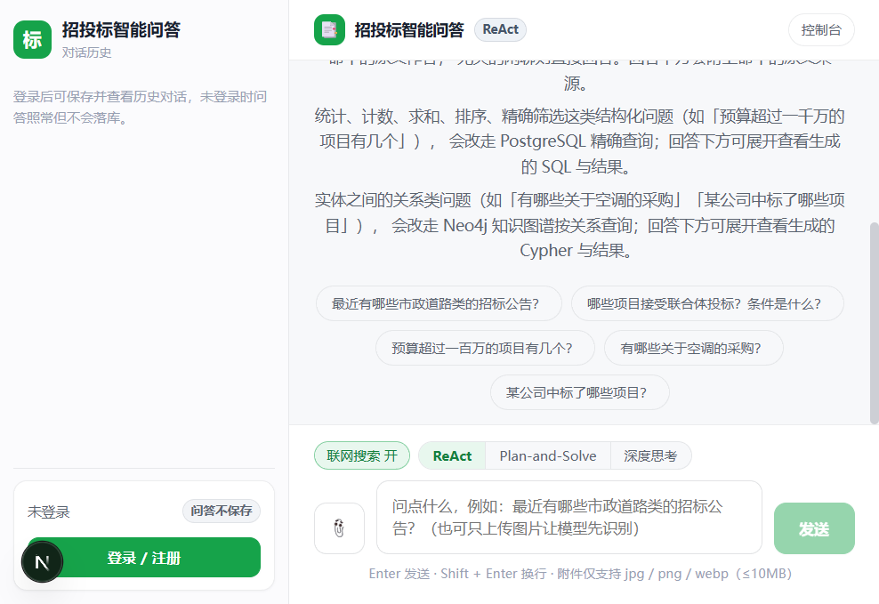
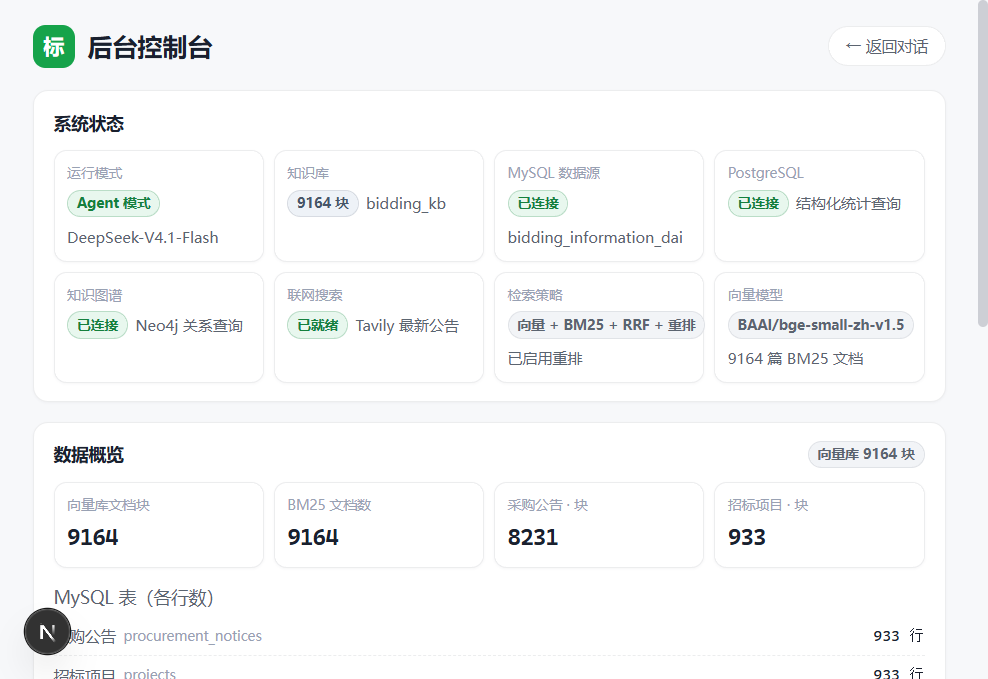
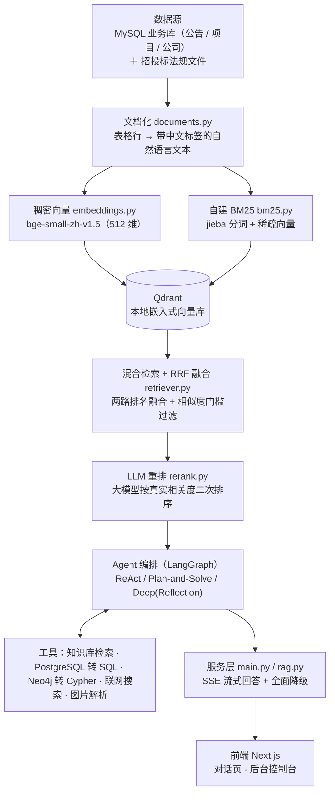

# 招投标智能问答机器人（bidding-qa-chatbot）

> **一句话定位**：把招投标业务库里的结构化数据「翻译」成可检索的知识，让使用者用**一句自然语言**就能查公告、比项目、算统计、追关系——答案带出处，不编造。

## 它解决什么问题

招投标场景的信息散落在三类互不相通的数据里，传统做法要么靠人肉翻库，要么靠关键词死搜：

| 数据形态 | 典型问题 | 传统方式的痛点 |
|---|---|---|
| 招标公告 / 项目 / 公司的**正文** | 「市政道路工程的招标要求有哪些？」 | 关键词搜不到「意思相近但用词不同」的内容 |
| 结构化**明细字段** | 「预算超过 100 万的项目有几个？」 | 关键词检索不会做 count / sum |
| 实体之间的**关系** | 「这家公司中标了哪些项目？」 | 表格查不了多跳关系 |

本项目把这三类问题统一到一个对话入口：**正文走混合检索（语义 + 关键词）**，**统计走 PostgreSQL 自然语言转 SQL**，**关系走 Neo4j 图谱查询**，由 Agent 自主判断该用哪条路，全程 SSE 流式返回，并给出可点击的来源卡片。

## 界面截图

主对话页（三栏布局：会话栏 + 对话区 + 输入区）：



后台控制台 `/admin`（数据概览、MySQL/PG/图谱结构、检索调试台、历史检索）：



## 架构



纯文本版（便于在任意环境阅读）：

```
MySQL 业务库 / 招投标法规文件
        │
        ▼  文档化（表格行 → 自然语言文本，字段名取自库里的列注释）
   稠密向量（bge-small-zh）          自建 BM25（jieba 分词 + 稀疏向量）
        │                                   │
        └──────────────┬────────────────────┘
                       ▼
              Qdrant 本地嵌入式向量库
                       │
                       ▼
        混合检索 + RRF 排名融合 + 相似度门槛过滤
                       │
                       ▼
             LLM 重排（大模型二次排序）
                       │
                       ▼
   Agent 编排（ReAct / Plan-and-Solve / Deep+Reflection）
        ├── 知识库检索工具
        ├── PostgreSQL 自然语言转 SQL
        ├── Neo4j 自然语言转 Cypher
        ├── 联网搜索（Tavily）
        └── 图片解析（智谱视觉模型）
                       │
                       ▼
              SSE 流式回答（含来源卡片）
                       │
                       ▼
              前端 Next.js（对话页 / 后台页）
```

> 说明：当前建库脚本读取的是 MySQL 的三张业务表；「法规文件」可复用同一条「文档化 → 向量化」管线接入（扩展点）。

## 技术栈与选型理由

| 技术 | 用途 | 为什么选它 |
|---|---|---|
| **FastAPI** | 后端 Web 框架 | 原生异步 + Pydantic 自动校验入参，写 SSE 流式接口最顺手，自带 OpenAPI 文档 |
| **LangGraph** | Agent 编排 | 把 ReAct 循环显式建模成状态图，步数可控、可加递归上限，比手写 while 循环更稳 |
| **Qdrant（嵌入式本地模式）** | 向量库 | 不需要 Docker / 独立服务，一个目录就是全部数据，交付给面试官「clone 即可跑」 |
| **bge-small-zh-v1.5** | 中文向量模型 | 中文语义效果好、体积小（512 维），本地 CPU 可跑，无需 GPU |
| **自建 BM25** | 关键词检索 | 公司名、项目编号这类「精确词」语义模型反而不准；自建实现零依赖、可持久化、完全可控 |
| **RRF（排名融合）** | 两路结果合并 | 只依赖「排名」不依赖「分数」，免去向量分与 BM25 分不同量纲的归一化难题 |
| **大模型重排** | 二次排序 | RRF 只看排名、不看内容；重排让模型真的读一遍片段，把「词面像但答非所问」的挤下去 |
| **PostgreSQL** | 结构化统计 | 明细数据做 count / sum / 精确筛选比向量检索准得多；Agent 生成只读 SQL 即可 |
| **Neo4j** | 知识图谱 | 「公司—项目—公告」本质是关系网，多跳查询用图数据库是天生的强项 |
| **SQLite + FTS5** | 对话历史 | 零配置、单文件、全文检索开箱即用，不引入额外服务 |
| **PBKDF2-HMAC-SHA256** | 密码存储 | 标准库自带、无需第三方依赖；20 万次迭代显著抬高暴力破解成本 |
| **Next.js 16 + React 19 + TypeScript** | 前端 | App Router 支持 SSE 流式渲染；纯 CSS 变量做主题，无 UI 框架依赖 |
| **SSE** | 流式传输 | 比 WebSocket 简单、浏览器原生支持、天然单向推送，正好匹配「边生成边显示」 |

## 快速开始

### 0. 环境准备（先做这一步）

```powershell
# 1) 在项目根目录创建虚拟环境
python -m venv .venv
# 2) 安装后端依赖
.\.venv\Scripts\python.exe -m pip install -r requirements.txt
# 3) 复制配置模板，然后按需填写里面的值
Copy-Item .env.example .env
```

### 1. 启动后端

```powershell
cd backend
..\.venv\Scripts\python.exe -m uvicorn app.main:app --host 127.0.0.1 --port 8000
```

访问 <http://127.0.0.1:8000/api/health> 确认「向量库是否就绪 / 大模型是否已配置」。

### 2. 启动前端

```powershell
cd frontend
npm install
npm run dev
```

打开 <http://localhost:3000>（对话页）与 <http://localhost:3000/admin>（后台控制台）。

### 3. PostgreSQL（可选，供 Agent 做统计查询）

```powershell
# 1) 确保本机 PostgreSQL 已启动，并在 .env 填好 PG_USER / PG_PASSWORD / PG_DATABASE
# 2) 从远程 MySQL 同步明细数据到本机 PG（全量重建）
cd backend
..\.venv\Scripts\python.exe sync_pg.py
```

### 4. Neo4j（可选，供 Agent 做关系查询）

```powershell
# 1) 启动 Neo4j，并在 .env 填好 NEO4J_USER / NEO4J_PASSWORD
# 2) 从远程 MySQL 建图（幂等，可重复执行）
cd backend
..\.venv\Scripts\python.exe import_neo4j.py
```

### 5. 建知识库（把数据灌进向量库）

```powershell
# 方式 A：打开 /admin 页面，点「重建知识库」（推荐，能看到实时进度）
# 方式 B：命令行触发，然后轮询进度
curl -X POST http://127.0.0.1:8000/api/ingest
curl http://127.0.0.1:8000/api/ingest/status
```

### 备用：远程 MySQL → 本机 MySQL

```powershell
# 远程库连不上时，可先在本机留一份完整副本
cd backend
..\.venv\Scripts\python.exe copy_mysql.py --user root --password 你的密码
```

## 接口一览

| 方法 | 路径 | 说明 |
|---|---|---|
| GET | `/api/health` | 健康检查（含向量库是否就绪、大模型是否已配置） |
| GET | `/api/config` | 当前生效的配置（不含任何口令） |
| GET | `/api/mysql/schema` | 三张表的真实结构 + 行数 + 库内全部表名 |
| GET | `/api/pg/schema` | PostgreSQL 库结构（供 Agent 生成 SQL 用，只读自检） |
| GET | `/api/graph/schema` | Neo4j 图谱结构（供 Agent 生成 Cypher 用，只读自检） |
| POST | `/analyze-image` | 图片解析（multipart 上传，智谱视觉模型识别成文本） |
| GET | `/api/kb/stats` | 知识库统计（总块数、按表分布） |
| GET | `/api/kb/samples` | 知识库样本 |
| GET | `/api/retrieve?q=xxx` | 只做混合检索（默认不调大模型；带 `&rerank=true` 则额外重排） |
| POST | `/api/chat` | 问答（SSE 流式，先推参考来源再推回答） |
| POST | `/api/agent/chat` | Agent 问答（SSE 流式，三种模式 `react` / `plan` / `deep`；带 `web_search` 开关） |
| POST | `/api/ingest` | 重建知识库（后台任务） |
| GET | `/api/ingest/status` | 重建进度 |
| POST | `/api/auth/register` | 注册（返回令牌） |
| POST | `/api/auth/login` | 登录（返回令牌） |
| POST | `/api/auth/logout` | 注销（作废当前令牌） |
| GET | `/api/auth/me` | 当前登录用户 |
| GET | `/api/history/conversations` | 会话列表（可按标题关键词 / 模式过滤） |
| POST | `/api/history/conversations` | 新建会话 |
| GET | `/api/history/conversations/{id}` | 会话详情（含全部消息与元数据） |
| PATCH | `/api/history/conversations/{id}` | 重命名会话 |
| DELETE | `/api/history/conversations/{id}` | 删除会话 |
| GET | `/api/history/search` | 历史搜索（关键词 + 时间范围 + 主题 / 模式） |

## 关键参数说明

全部配置集中在项目根目录 `.env`（经 `backend/app/config.py` 汇总）；改完 `.env` **必须重启后端**（配置带缓存）。

| 参数 | 默认值 | 含义 |
|---|---|---|
| `RETRIEVE_DENSE_TOP_K` | `10` | **向量路**召回条数。语义检索先粗捞这么多条候选 |
| `RETRIEVE_SPARSE_TOP_K` | `10` | **BM25 关键词路**召回条数。两路各捞一批再融合 |
| `RETRIEVE_FINAL_TOP_K` | `5` | **最终送进大模型的条数**。融合 + 重排之后只保留这么多作为作答依据 |
| `RRF_K` | `60` | RRF 融合公式里的常数 k。**值越小，排名靠前的结果权重越突出**；60 是业界常用默认值，一般不用改 |
| `DENSE_MIN_SCORE` | `0.35` | 向量相似度**门槛**。低于该值**且**未被 BM25 命中的候选会被丢弃，用于拦住「语义检索硬凑出来的无关内容」。设为 `0` 表示关闭过滤 |
| `RERANK_CANDIDATES` | `10` | 进入重排的候选池大小。必须 **≥ `RETRIEVE_FINAL_TOP_K`**，否则没得挑 |
| `RERANK_MODEL` | 空 | 重排专用模型；**留空则复用 `LLM_MODEL`**。重排是简单排序任务，建议填快模型（如 `deepseek-flash`） |
| `RERANK_MAX_CHARS` | `300` | 每条候选送进重排提示词的最大字符数，用于压缩提示词、省 token |
| `RERANK_TIMEOUT` | `45` | 重排超时（秒）。推理模型思维链较慢，**给小了会频繁「静默降级」回 RRF 原序**（实测 20 秒不够，45 秒才稳） |

其他值得注意的硬约束参数：`AGENT_MAX_STEPS=6`、`DEEP_STEP_MAX_STEPS=6`（步数给小会撞 LangGraph 递归上限）、`LLM_MAX_TOKENS`（推理模型会先消耗思维链，给小会导致正文为空）。

## 运行测试

```powershell
cd backend
..\.venv\Scripts\python.exe -m pytest tests -v
```

`backend/tests/` 下的用例全部**离线**运行（`conftest.py` 预置假环境变量，不连真实数据库 / 向量库 / 大模型，也不触碰 `data/` 目录），覆盖 BM25 打分、RRF 融合、重排解析、文档切块四个核心纯函数模块。

## 已知限制

1. **Qdrant 本地嵌入式模式为单进程独占**。`data/qdrant/` 同一时刻只允许一个进程打开，因此「重建知识库」只能用「后台线程 + 进程内锁」串行化实现。
2. **PostgreSQL / Neo4j 工具只在配置齐备时才注册给 Agent**。`PG_USER`/`PG_PASSWORD` 或 `NEO4J_URI`/`NEO4J_USER`/`NEO4J_PASSWORD` 任一为空时，对应工具不注册，`/api/pg/schema`、`/api/graph/schema` 返回「未配置」而非报错——Agent 不会去调用一个必然失败的工具。
3. **多进程部署当前不可用**。受第 1 条限制，不能用 `uvicorn --workers N` 或 Gunicorn 多 worker；Qdrant 嵌入式存储会被多进程争抢。生产化需要改用 Qdrant Server 模式。
4. **数据源依赖远程局域网 MySQL**（`.env` 中的 `MYSQL_HOST`，默认示例为 `192.168.x.x`）。外部环境无法访问该库，需要自备数据或先用 `copy_mysql.py` 留底。
5. **首次运行需要下载向量模型**（`BAAI/bge-small-zh-v1.5`）。国内网络建议在 `.env` 里走镜像：`HF_ENDPOINT=https://hf-mirror.com`、`HF_HUB_DISABLE_XET=1`。
6. **重排 / Agent / 图片解析 / 联网搜索都依赖外部 API Key**。未配置时不会报错，而是**自动降级**：无 `LLM_API_KEY` 时退化为「仅检索」模式，无 `ZHIPUAI_API_KEY` 时 `/analyze-image` 返回 502，无 `TAVILY_API_KEY` 时联网搜索工具不注册。
7. **对话历史与账号体系默认开启**（`AUTH_ENABLED=true`），历史按用户分区，未登录无法访问 `/api/history/*`。

## 目录结构

```
bidding-qa-chatbot/
├── backend/
│   ├── app/                    后端核心模块（config/db/documents/检索/Agent/服务层/账号…）
│   ├── tests/                  pytest 离线单元测试
│   ├── copy_mysql.py           远程 MySQL → 本机 MySQL（数据留底）
│   ├── sync_pg.py              远程 MySQL → 本机 PostgreSQL（统计查询）
│   └── import_neo4j.py         远程 MySQL → Neo4j 知识图谱（关系查询）
├── frontend/                   Next.js 前端（对话页 + /admin 后台控制台）
├── data/                       运行时数据（向量库 / BM25 索引 / 历史库，不入库）
├── docs/                       界面截图
├── .env.example                配置模板（真实 .env 不入库）
├── .gitignore
├── requirements.txt
└── README.md
```